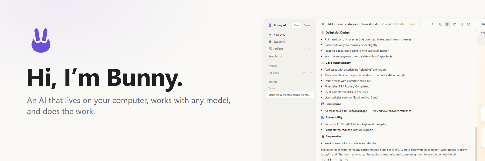
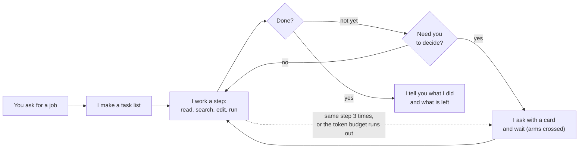
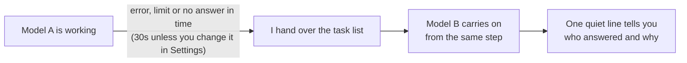
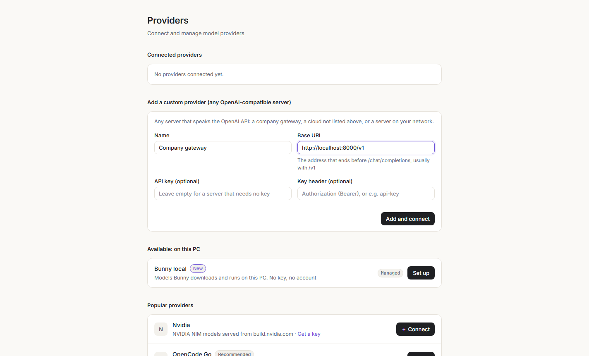
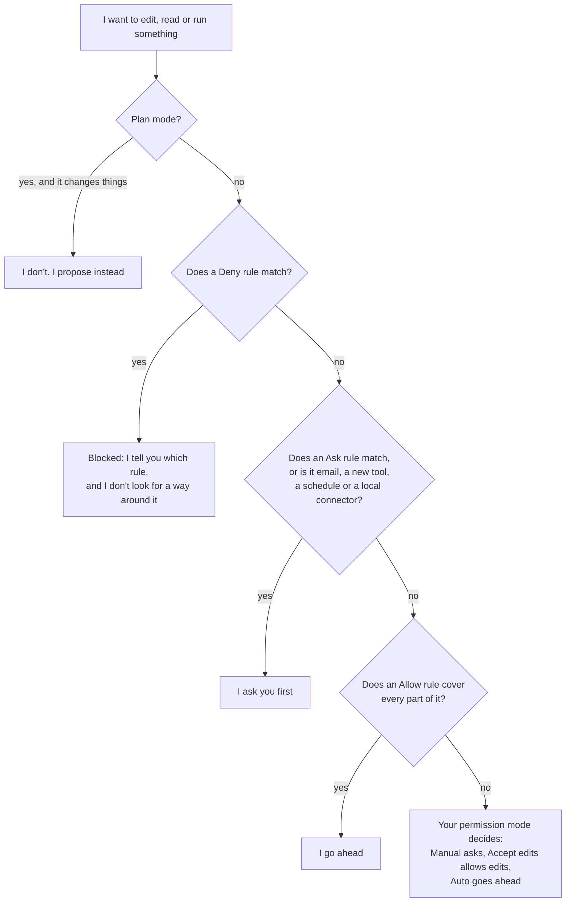
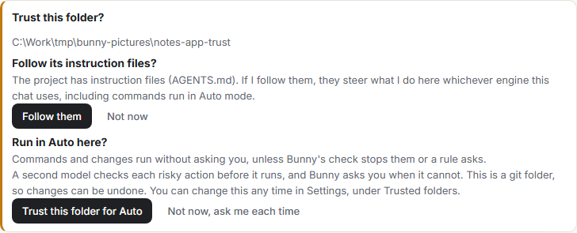
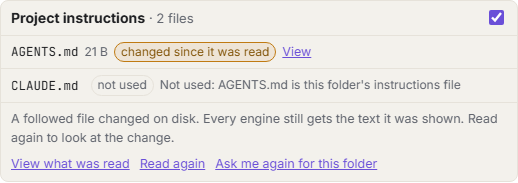
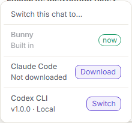
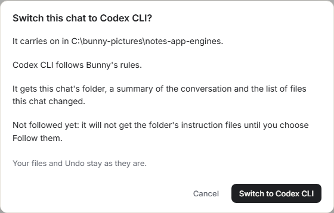

<picture>
  <source media="(prefers-color-scheme: dark)" srcset="docs/images/hero-dark.png" />
  
</picture>

<h1 align="center">Hi, I'm Bunny. Pay attention.</h1>

<p align="center">
  <b>I'm the AI that lives on your computer, works with any model you like, and actually does the work. Yes, all of it.</b><br/>
  I chat, write code, build little apps, browse, read your documents, handle GitHub and keep going until the job is done. You're welcome.<br/>
  Your chats and keys stay with me, on your machine. The only thing I send out is your request, to the model <i>you</i> picked. I don't gossip.
</p>

<p align="center">
  <a href="../../releases/latest"><b>Download me. Now, please.</b></a> ·
  <a href="#who-im-for">Who I'm for</a> ·
  <a href="#problems-i-solve">Problems I solve</a> ·
  <a href="#see-me-work-real-jobs-real-prompts">Examples</a> ·
  <a href="#everything-i-do">Everything I do</a> ·
  <a href="#the-house-rules">House rules</a> ·
  <a href="#what-i-keep-to-myself">Privacy</a>
</p>

<p align="center">
  
</p>

> **A note on what's shipped.** Everything here is in the v0.1.14 build unless it carries the label **🆕 v0.1.15 (not released yet)**. Those labelled parts are being built right now. Each sits between V0115 markers, so it can be cut whole if it slips.

---

## Meet me

I'm a **Windows desktop app**. One window, one chat box, and behind it a crowd of things I can actually do: write and run code, build live apps, search the web, read your files, work with GitHub, remember what matters, and run jobs on a schedule while you're away.

I'm not tied to one company. Pick any model (I know 23 providers, plus anything that speaks the OpenAI language, plus models on your own PC) and I work the same way. Prefer a different coding engine? I can hand a Code chat to **Claude Code** or **Codex CLI** too.

| | |
|---|---|
| **What I am** | A desktop AI app for Windows, with a built-in engine and optional Claude Code and Codex CLI engines |
| **Whose models** | Yours: 23 providers, free ones included, any OpenAI-compatible server, and Ollama on your own PC |
| **Where your stuff lives** | On your computer, in your user folder. Keys are locked with Windows' own encryption |
| **Who's in charge** | You. Permission modes, rules and cards that ask before anything risky |
| **How you get me** | The installer in the [latest release](../../releases/latest), or run me from source |

---

## Who I'm for

- **People who want one AI app for every model.** You have a free key from one place, a paid key from another, and a local model on the side. I put them in one chat, and Auto picks a model for each message.
- **Developers.** I read your project, search it properly, edit files, run your tests, keep a plan as a checklist, undo my own file changes, run your dev server and open pull requests.
- **Makers who want a thing built, not explained.** Ask for a to-do app, a game or a landing page and it opens beside the chat, live, in a sandbox.
- **Anyone drowning in documents.** PDFs, Word, Excel, PowerPoint, scanned pages and pictures with text in them: I read them, you ask questions.
- **The careful.** Nothing important happens without your say-so, and the important settings can only be changed from my own window.
- **People on the move.** Sign in a phone or another computer over your network and use me from there.

---

## Problems I solve

| You're tired of… | So I… |
|---|---|
| One AI company's models and one company's cloud | Work with 23 providers and any OpenAI-compatible server, and keep your chats and keys on your PC |
| AIs that explain how to do it instead of doing it | Make the app, edit the code, run the tests, browse the page |
| Typing "continue" every few minutes | Keep going on long jobs, show "Still working · step 140", and ask only when I truly need you |
| A model that stalls halfway | Move the job to the next model |
| Not knowing what the AI is allowed to do | Follow a permission mode and your Deny / Ask / Allow rules, and say which rule stopped a step |
| Changes you didn't want | Put every file a reply changed back with one **Undo** button |
| A wall of code in the middle of a chat | Fold long code, with **Show all**, **Copy** and **Save as artifact** |
| Wanting a quick answer without opening the full app | Pop up **Quick ask**, a light floating bar, with sources under each answer |

---

## See me work: real jobs, real prompts

These are things you can type today. What I do is described from how I really behave; I don't promise exact words, because models differ.

### 1. "Build me a to-do app with a carrot theme"
**You say:** *Make a to-do app with a carrot theme. Let me tick things off and save them.*
**I do:** Build it as an **artifact**, a live page that opens beside our chat in its own sandbox. I give you a short summary, not a wall of code. Every change you ask for becomes a new version.
**You see:** the app next to the chat, plus a version list.

### 2. "Fix the failing tests in this project"
**You say (in Code mode, with your folder chosen):** *The tests in this project fail. Find out why and fix it.*
**I do:** Read the project, search it (regular expressions and file patterns), show my plan as a checklist that ticks off as I go, edit the files, run your tests and keep going until they pass or I need you to decide something. In **Manual** mode I ask before each edit and command; in **Accept edits** I make the edits and still ask before commands.
**You see:** a ticking checklist, the test output, and an **Undo** button on every reply that changed files.

<p align="center"></p>

### 3. "Do this big job while I make tea"
**You say:** *Refactor the pricing code to use cents, update the tests and tell me what you changed.*
**I do:** Work through it without nagging you to type "continue". I keep a task list, show "Still working · step 140" so you know I'm not napping, and if one model fails I move the job to the next one. I check with you before one job uses more than 5 million tokens, and if I catch myself going round in circles, I stop and ask.
**You see:** one tidy working line you can open to read my thoughts, and a summary of what I did and what's left.

<p align="center"></p>

### 4. "What does this folder of contracts say about renewals?"
**You say:** *Read these PDFs and Word files and tell me which contracts renew automatically.*
**I do:** Read PDF, Word (even old .doc), Excel, PowerPoint, OpenDocument, EPUB and RTF files, plus the words inside pictures and scanned pages using text recognition built into Windows, and answer from them.
**You see:** an answer built from your documents, not from guesswork.

### 5. "Look into this and give me sources"
**You say:** *Compare the three most-used open-source note apps and tell me where each one is weak. Cite your sources.*
**I do:** Search the web (the search words go to DuckDuckGo) and read pages, and cite what I used.
**You see:** an answer with the pages I used.

### 6. "Find my tax return" (from the Quick ask bar)
**You say (in the floating bar):** *Find the file called tax return from last year.*
**I do:** I search the files Windows has indexed: names, folders, dates and snippets. Folders such as Windows, Program Files, AppData and the ones that hold keys are always left out, and you can add your own under **Excluded folders**. As things stand in v0.1.14 it is off until you turn it on in **Settings → Capabilities**, and then I open up to three of the best matches, read up to three of them, and answer from them with links.

<!-- V0115:begin search-pc-default -->
> **🆕 v0.1.15 (not released yet):** Search this PC is on for finding only. I show what I found (names, folders, dates), the first search says so and where to turn it off, and in **Settings** you can turn it off or choose **Read the files, then answer** instead.
<!-- V0115:end search-pc-default -->
**You see:** the answer, **Sources** chips under it and [1], [2] marks showing which files I used.

<!-- V0115:begin quick-ask-note -->
> **🆕 v0.1.15 (not released yet):** Quick ask gets more dependable. When a model ignores its tools, I run one web search myself and answer from it; a "Search this PC is off" card has a button straight to the switch; and the bar names the tools it really has.
<!-- V0115:end quick-ask-note -->

### 7. "Review my pull requests"
**You say:** *Look at the open pull requests in my repo and tell me which have failing checks.*
**I do:** Using the GitHub CLI you already signed in with, or a token, search repositories, read files, issues and pull requests (with their checks), and report. Opening issues or pull requests and commenting always ask first.
**You see:** a list of pull requests with their check results, and a card before anything is written to GitHub.

### 8. "Every Monday, summarise my week"
**You say:** *Every Monday morning, collect my calendar and unread mail and write me a summary.*
**I do:** Set up a **scheduled task**. Setting up a schedule that changes things asks you first, and Gmail, Calendar and Drive only work if you allowed them at Google sign-in. I search and read mail, write drafts (sending always asks), and see and add calendar events.
**You see:** the schedule in my task list, and the results when it runs.

### 9. "Use two helpers to review this code"
**You say:** *Have two helpers review this code, one for bugs and one for readability, and combine their reports.*
**I do:** Call helper agents that work side by side, each on a model that suits its part, then put their reports together. Every helper's work is kept as a chat under yours.
**You see:** nested chats in the sidebar and one combined answer.

<p align="center"></p>

### 10. "Run the dev server and check the page"
**You say:** *Start the dev server, open the page and tell me if the header looks broken.*
**I do:** Start the program, read its output, open the page in my browser, and stop it when I'm done. It gets its own tab in the **Terminal** pane with live output and a Stop button. When I close, the programs I started close with me.
**You see:** the terminal tab, the page, and my verdict.

<p align="center"></p>

### 11. "Use Bunny from my phone"
**You do:** Turn on **Allow other devices to open Bunny**, open the address on your phone and sign in. In my window, give that device a level: **Chats** (the default) or **Everything**.
**I do:** Serve the chat to the phone over your network only. A chip in my top bar shows signed-in devices; tap it for each device's level, last-seen time and **Activity**, which lists tool names and setting changes (never the details) for the last 500 entries or 30 days.
**You see:** me on your phone, with the same chats.

### 12. "Do this one in Claude Code"
**You do:** In **Settings → Engines**, download **Claude Code** (or **Codex CLI**) on your click, then pick it in the chip next to the chat box before your first message.
**I do:** Run that Code chat on the engine you picked, unmodified, in the version I tested. If an engine can't send every action through me, it first works in a copy of your folder (restricted mode) and I check every changed file against your rules before asking **Keep N changes from the engine?**
**You see:** the same chat, a different engine underneath.

<!-- V0115:begin examples-note -->
> **🆕 v0.1.15 (not released yet):**
> - **Make Office files.** Ask for a Word, Excel or PowerPoint file and I create it.
> - **Edit an engine's own rules** as lists: Deny, Ask and Allow, one rule per row, with an add-rule line, and a read-only list of what's always protected.
> - **Fix the Claude sign-in.** I read the sign-in address Claude Code prints, limited to https on claude.ai, claude.com and anthropic.com, and open it in your normal browser.
<!-- V0115:end examples-note -->

---

## Everything I do

### I keep going until the job is done
I keep a task list and tell you "Still working · step 140". If a model gives up, another takes the task over: how long I wait first is yours to set under **Settings → Models → Wait for a first reply** (15, 30, 60, 90 or 120 seconds, or your own number from 10 to 600; 30 is the default; reasoning, image and video models get twice that, up to 600). I stop when it's finished, when you press **Stop**, or when I truly need you, and then I ask with a card.





<p align="center"></p>

### You can watch me think. On one tidy line.
While I work, one little line at the bottom of my reply shows me hopping along ("Snuggling the code… thinking · 12s"). Open it and read my thoughts as they happen. When I move on, it settles into a quiet "Thought for 12s" you can open later. If a model is being slow, I tell you exactly who's keeping us waiting.

<p align="center"></p>

### I build apps you can use straight away
Apps, games and landing pages open as **artifacts** beside the chat, each in its own sandbox, and every change is kept as a new version.

### Real coding, with a plan and an undo button
In Code mode I read your project, search it (regular expressions, file patterns, context lines), edit files (one change, every match, or several at once), run your tests and show my plan as a checklist. Every reply that changed files gets an **Undo** button that puts them back exactly as they were. Changes made by commands I ran are not undone, and I say so.

### I ask for what I need. Nicely.
When a job needs something I don't have yet (switching to Code mode, controlling the desktop, building a new tool, finding a plugin) I say so with one card. One click and I carry on in the same reply.

<p align="center"></p>

### I bring friends, and I run your servers
**Helper agents** work in parallel and report back. Programs that keep running (a dev server, a watcher) get their own Terminal tab.

### Tidy answers
Long code arrives folded with **Show all**, **Copy** and **Save as artifact**. Tables, highlighting and Markdown render while I'm still typing.

<p align="center"></p>

### I work with GitHub
Search repositories, read files, issues and pull requests (with their checks), open issues and pull requests, comment and clone private repositories. Anything that writes to GitHub, I ask first.

### Any model, from anywhere
ModelScope, SiliconFlow, Gitee AI, DeepSeek, Moonshot (Kimi), Zhipu (GLM), Alibaba Qwen, Groq, Together, Mistral, xAI, Fireworks, Cerebras, OpenAI, Anthropic, Google, OpenRouter, Nvidia, Vercel, GitHub Copilot, OpenCode and Ollama on your own machine, each with a **Get a key** link. Any other OpenAI-compatible server is one form away. When you first connect a provider, I tell you if my "free models only" filter is hiding some of its models, and show you all of them with one click.

<p align="center">
  
  
</p>

### Sign in with GitHub or Google
Link your GitHub or Google account if you want. There's still no cloud account: your chats and keys stay on this computer.

<p align="center"></p>

### Engines: Bunny, Claude Code, Codex CLI
A Code chat runs on my own engine (the default) or on **Claude Code** or **Codex CLI**, each downloaded on your click, unmodified and pinned to a version I've tested. Nothing is installed with me.

- **Settings → Engines** has a **Local | Account** switch per engine, with the recommended one marked. Claude Code: Account is recommended; you sign in with your own Anthropic account and I never see or store that sign-in. Local runs it on my endpoint and your models, which Anthropic doesn't support, so it may stop working after an update. Codex CLI: Local is recommended; Account is greyed out while signing in to Codex is still being tested.
- **Update** appears when a tested newer version is ready; **···** → **Roll back** returns to the earlier one I keep.
- **Engine for new chats** sets the default; in a chat the engine chip lists the downloaded engines until your first message, then it's fixed for that chat.
- **Use Bunny's engine** is on by default (my rules decide each step). Turn it off and new chats follow the engine's own rules, which you set in Settings → Engines. I ask first, and this is the warning:

> Bunny's engine is off. Chats run on Claude Code and follow Claude Code's rules, which you set here. Bunny no longer checks each step against your Bunny rules, including your Deny rules: Claude Code asks you itself, and Bunny shows its questions. Bunny still blocks its own data, its keys and the engines' sign-ins. A command you allow can read any file on this PC that you can.

The first Codex chat in a project can take a few minutes to start while Windows sets up its sandbox identity for that folder; later chats in the same project start in seconds.

### Everything says Bunny
Plugins, skills and downloads from other apps are shown in my words: a `SKILL.md` is a skill file, a `CLAUDE.md` is my instructions. Plugins made in another app's layout install and work in me. Hooks and scripts made for other apps are listed and say plainly that they don't run in me yet.

### And, fine, a lot more
- **I read your documents:** PDF, Word (even ancient .doc), Excel, PowerPoint, OpenDocument, EPUB and RTF, plus the words inside pictures and scanned pages, using text recognition built into Windows.
- **I see pictures** with models that can, and read their text for models that can't.
- **I use a browser panel:** I open pages, read them, click and type, with you watching.
- **I can control the desktop** when you allow it: look at the screen, click, type and press keys.
- **I build my own tools** when nothing else fits: small scripts you read and approve before I save them.
- **I remember** lasting facts you share, and **I run tasks on a schedule**.
- **Auto picks the model** for each message, moves on when one doesn't answer, and tells you who answered.
- **Projects, branches, search, incognito chats, voice input, read-aloud, import and export.**
- **Connectors (MCP), skills and plugins** for even more of me, including local connectors that run as a program on your PC (you confirm the exact command).
- **Gmail, Calendar and Drive** when you allow them at Google sign-in: I search and read mail, write drafts (sending always asks), see and add events, and read Docs and Sheets.
- **Your phone or another computer:** with **Allow other devices to open Bunny** on, a signed-in device reaches me on your network. You give each device a level from my window only: **Chats** (the default) or **Everything**. A device at Everything is signed out after 30 minutes idle (Chats: 2 hours). A chip in my top bar shows the devices signed in; there's no banner. The setting stays on after a restart, and on a different network, such as a café's Wi-Fi, I don't open myself again on my own.
- **Phones fit:** on a phone the chat top bar becomes a menu, the title, the devices chip and a more button; Settings is a list that opens each section.
- **Tighter rows:** connectors, skills, plugins and the other lists take one row per item, with the switch on the same line.
- **Quick ask:** a light floating bar for a quick question, with the answer opening below it. It can search the web and read pages, cites its sources, and in the bar I can only search and read; I can't change files or run anything. **Ctrl+Enter** opens the chat in me, and with no model connected it offers **Open Bunny settings**.
- **13 fonts and instant themes:** Inter, Source Sans 3, IBM Plex Sans, Atkinson Hyperlegible, Lexend, Nunito, Quicksand, Lora, Literata, Source Serif 4, Noto Serif, JetBrains Mono and IBM Plex Mono are built in. Changing the theme applies at once everywhere. Licences are under **Settings → About**.
- **Chats open without a reload:** Back and Forward work, and Ctrl-click opens a chat in a new window.
- **Settings stay put:** what you change is kept after a restart, and each Settings tab shows only its own settings.

---

## The house rules

You decide what I may do. I'll grumble, but I'll obey.

| Mode | What I do |
|---|---|
| **Manual** | I ask before every edit, command or click |
| **Accept edits** | I make file edits; commands and desktop clicks still ask |
| **Auto** | I work on my own; I still ask before building a new tool, setting up a schedule that changes things, adding a local connector, or sending email |
| **Plan** | I only look, and propose a plan |

**Permission rules** go further: in **Settings → Code** you can tell me "always allow `npm test*`", "always ask before `git push*`" or "never touch `secrets/**`", for every folder or just one. Deny always wins, Plan mode still means look-only, and **Try a command** shows what I'd do without running anything. The rules are a guard rail against my mistakes, not a sandbox.

<p align="center">
  
  
</p>



**Only you get to change the important settings.** In the desktop app, my permission mode, rules, connectors, schedules, sign-ins, providers, update settings and similar switches change only from my own window, so no other program on your PC can quietly change what I'm allowed to do. Desktop control and tool-building stay off until you switch them on, in Settings or from the card I show when I need them.

---

## Coming in v0.1.15

> **🆕 v0.1.15 (not released yet).** Nothing in this section is in v0.1.14. Each item is a block that can be cut if it doesn't make it.

<!-- V0115:begin office-files -->
- **Office files.** Ask me for a Word, Excel or PowerPoint file and I make it.
<!-- V0115:end office-files -->
<!-- V0115:begin engine-rule-lists -->
- **Rule lists for engines.** In **Settings → Engines**, an engine's own rules become Deny, Ask and Allow lists, one rule per row, with an add-rule line and a read-only list of what's always protected, whatever the rules say.
<!-- V0115:end engine-rule-lists -->
<!-- V0115:begin signin-open -->
- **Claude sign-in opens.** I open the sign-in address Claude Code prints, limited to https on claude.ai, claude.com and anthropic.com, in your normal browser.
<!-- V0115:end signin-open -->
<!-- V0115:begin quick-ask-dependable -->
- **Quick ask that just works.** When a model ignores its tools I run one web search myself; a "Search this PC is off" card links to the switch; the bar names the tools it really has.
<!-- V0115:end quick-ask-dependable -->
<!-- V0115:begin project-instructions -->
### Your project's instruction files
A folder can carry `AGENTS.md` or `CLAUDE.md` (and `.cursorrules` or `.cursor/rules`). The first time you open such a folder in a chat, I show them in a card instead of quietly obeying them: **Read** shows the text, **Follow them** uses it, and **Not now** asks again later.

Once you follow a folder, **Bunny, Claude Code and Codex CLI all get the same text, the text you were shown**, and none of them reads the files by itself. If somebody edits a file afterwards, the Working folder card says **changed since it was read** and keeps using the old text until you choose **Read again**, which shows the difference first; **Use the new text** or **Keep the old text** then decides. A file that isn't used is listed as such, and **Ask me again for this folder** forgets your answer. Only my own window can answer, not a phone.

<p align="center"></p>

<p align="center"></p>
<!-- V0115:end project-instructions -->
<!-- V0115:begin rewind -->
- **Rewind.** A list of a chat's checkpoints, one per reply that changed files, so you can go back further than one reply and see what each step restores before you confirm.
<!-- V0115:end rewind -->
<!-- V0115:begin engine-switch -->
### Switch a chat to another engine
Open the engine chip in a Code chat and pick **Switch this chat to…**. Bunny, Claude Code and Codex CLI are listed. An engine that can't take the chat says why on its row, with the button that fixes it (**Download**, **Turn on**, **Sign in**), and a chat needs a working folder first.

Before it happens, I say what the new engine gets: this chat's folder, the folder's instruction files you chose to follow, a summary of the conversation and the list of files this chat changed. Answers that used files from your PC are left out. Your files and **Undo** stay as they are, and a line in the chat shows where the engine changed. A switch waits until the current reply has finished, and only my own window can do it, not a phone.

<p align="center"></p>

<p align="center"></p>
<!-- V0115:end engine-switch -->
<!-- V0115:begin settings-overhaul -->
- **A clearer Settings,** after every setting has been checked to work, stick and read clearly.
<!-- V0115:end settings-overhaul -->

---

## Get started (I'll wait. Not long.)

**Download for Windows**

Grab the **Bunny-AI-Setup** installer from the [latest release](../../releases/latest), run it, open **Providers**, connect a model (Nvidia and OpenRouter have free ones), and say hi.

I'm not code-signed yet, so Windows SmartScreen may say it doesn't recognise me. Choose **More info**, then **Run anyway**.

**Or build me yourself**

```bash
npm install
npm run dist
```

This writes the installer to `dist/`.

**Updates**

I check GitHub Releases a few seconds after I start and every few hours. A newer version downloads in the background and is checked against the fingerprint published with it; a bar then offers **Restart to update**, and if you just quit, I install it then. Switch this off, or check at once, in **Settings → About**.

**Run me in your browser instead**

```bash
npm install
npm start
```

Then open the address I print.

**Publishing a new version**

1. Raise `version` in `package.json` (installed copies only move to a higher number).
2. `npm run dist`
3. `npm run release` (uses the GitHub CLI; add `-- --notes-file notes.md` for your own notes)

`npm run release -- --dry-run` runs every check and prints all the ones that fail, publishing nothing. `--target <sha>` names the commit to release (default `HEAD`). A release is refused unless the checked-out commit is the target and is exactly `origin/main`, the working tree has no uncommitted or untracked files, and `dist/build-sha.txt` (written by `npm run dist`) names the same commit, so the installer is always built from what is released.

**Run the tests**

```bash
npm run test:all
```

`node scripts/gate.mjs` runs the unit tests, the end-to-end tests, a dependency audit and a secret scan together. `docs/FEATURE-TALLY.md` lists features with the test that proves each one. Trust, but verify.

---

## What I keep to myself

- Your chats, artifacts, memories and settings are stored in your user folder on this computer.
- Keys and sign-in tokens are encrypted with Windows' own protection and never shown again in full.
- What I send out: your requests to the model provider you chose; the pages you or I open; the search words I send to DuckDuckGo when I run a web search; the mail, calendar and Drive requests I make when you allow Google; GitHub or Google when you sign in; a check for updates on GitHub Releases; and, when the network seems down, a tiny "am I online?" check to Google, Cloudflare or Apple connectivity addresses (no data, cookies or identifiers).
- A phone or other computer signed in over your home network talks to me on that network only. Its chats go to the model provider you chose, the same as chats in my window.
- Pages I build run in a sandbox and can't reach the app. Only my own windows talk to my local server, unless you allow other devices.

<p align="center"><sub>Made with love for people who want a capable AI on their own terms. Now go connect a model. I'm waiting. 🐰</sub></p>
