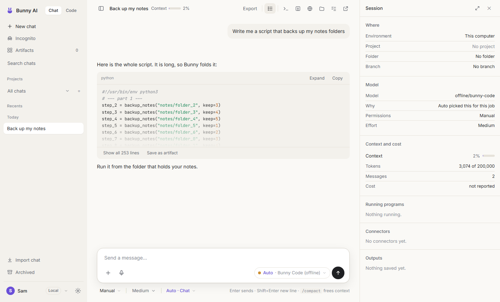
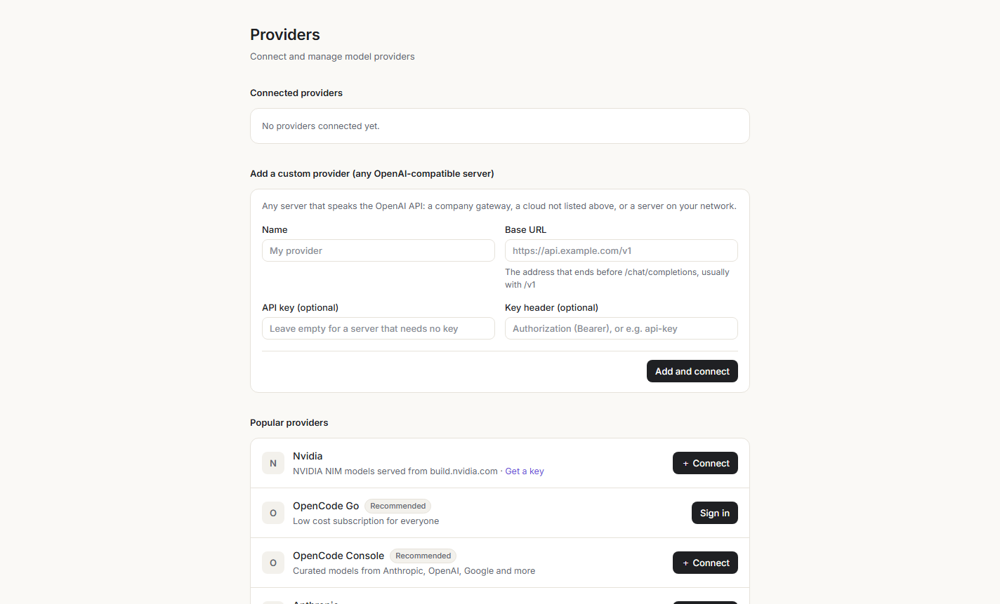

<p align="center">
  
</p>

<h1 align="center">Bunny AI</h1>

<p align="center">
  <b>Your AI workspace. Your models, your keys, your computer.</b><br/>
  A desktop AI app that chats, codes, builds apps, browses, reads your documents and works with GitHub,<br/>
  with any model you like, and nothing leaving your machine except the request to the model you chose.
</p>

<p align="center">
  
</p>

---

## Why Bunny AI

Most AI apps lock you into one company's models and one company's cloud. Bunny AI turns that around.

- **Bring any model.** 23 providers built in, from OpenAI and Google to ModelScope, SiliconFlow and Gitee AI, plus any OpenAI-compatible server you add yourself. Free models work too.
- **It does the work, not just the talking.** Bunny makes apps, edits code, runs programs, browses the web, reads PDFs and Word files, and opens pull requests.
- **You stay in charge.** Every change follows the permission mode you pick, every file edit can be undone, and when Bunny needs something new it asks with one clear card.
- **Private by design.** Chats, keys and files stay on your computer. Keys are encrypted with Windows' own protection.

---

## What it can do

### Build apps and pages you can use straight away
Ask for a to-do app, a game or a landing page and Bunny builds it as an **artifact**: a live page that opens beside the chat, in its own sandbox. The chat gets a short summary instead of a wall of code, and Bunny can open the page in its browser and click through it to check it works. Every change is kept as a new version.

### Asks for what it needs, instead of working around it
When a job needs something Bunny does not have yet, it says so with a card: switch to Code mode, control the desktop, build a new tool, or find a plugin. One click and the new abilities arrive in the same reply.

<p align="center"></p>

### A team of helpers, each on the right model
Big jobs get split up. Bunny hands parts to **helper agents** that work side by side, then combines their reports. Each helper can run on the model best suited to its part (a coding model for the code review, a writing model for the product blurb) instead of the model you are chatting with. Every helper's work is kept as a chat nested under yours, so you can open it and see exactly what it did. Chats can also start background chats and message each other.

<p align="center"></p>

### Real coding, with a plan you can follow and an undo button
In Code mode Bunny reads your project, edits files, runs your tests and shows its plan as a checklist that ticks off as it goes. Every reply that changed files has an **Undo file changes** button that puts them back exactly as they were.

<p align="center"></p>

### Runs your dev server and keeps an eye on it
Bunny can start programs that keep running, such as a dev server or a watcher, read their output, open the page in its browser, and stop them when it is done. Each one gets its own tab in the Terminal pane, with live output and a Stop button.

<p align="center"></p>

### Tidy answers
Long code arrives folded with **Show all**, **Copy** and **Save as artifact**, so a reply stays readable. Tables, highlighting and Markdown all render while the answer streams in.

<p align="center"></p>

### Works with GitHub
Sign in with the GitHub CLI you already use, or a token, and Bunny can list and search repositories, read files, issues and pull requests (with their checks), open issues and pull requests, comment, and clone private repositories. Anything that writes to GitHub asks first.

### Any model, from anywhere
ModelScope, SiliconFlow, Gitee AI, DeepSeek, Moonshot (Kimi), Zhipu (GLM), Alibaba Qwen, Groq, Together, Mistral, xAI, Fireworks, Cerebras, OpenAI, Anthropic, Google, OpenRouter, Nvidia, Vercel, GitHub Copilot, OpenCode and Ollama on your own machine. Each one has a **Get a key** link. And any other OpenAI-compatible server is one form away, with its own key header if it needs one.

<p align="center">
  
  
</p>

### Sign in with GitHub or Google
Link your GitHub or Google account to Bunny. There is still no cloud account: your chats and keys stay on this computer.

<p align="center"></p>

### And a lot more
- **Reads your documents:** PDF, Word (including old .doc), Excel, PowerPoint, OpenDocument, EPUB and RTF, plus the words inside pictures and scanned pages, using text recognition built into Windows.
- **Sees pictures** with models that can, and reads their text for models that cannot.
- **Uses a browser panel:** opens pages, reads them, clicks and types, with you watching.
- **Controls the desktop** when you allow it: looks at the screen, clicks, types and presses keys.
- **Builds its own tools** when nothing else fits: small scripts you read and approve before they are saved.
- **Remembers** lasting facts you share and **runs tasks on a schedule**.
- **Auto picks the model:** it chooses one for each message, falls back when one does not answer, and tells you which answered.
- **Projects, branches, search, incognito chats, voice input, read-aloud, import and export**, and the interface in English, Spanish, French and Arabic (the newest screens are English for now).
- **Connectors (MCP), skills and plugins** to add more abilities, including local connectors that run as a program on your PC (you confirm the exact command).
- **Gmail, Calendar and Drive** when you allow them at Google sign-in: search and read mail, write drafts (sending always asks), see and add events, read Docs and Sheets.
- **Never stuck on a busy model:** when the model you picked hits a rate limit, the best other model answers, and the reply says so.
- **See how it thinks:** models that share their reasoning show it folded above the reply.
- **Scheduled tasks that use tools,** and background chats that tell you when they finish.

---

## You decide what it may do

| Mode | What happens |
|---|---|
| **Manual** | Bunny asks before every edit, command or click |
| **Accept edits** | File edits go ahead; commands and desktop clicks still ask |
| **Auto** | Bunny works on its own; building a new tool still asks |
| **Plan** | Bunny can only look, and proposes a plan |

Desktop control and tool-building are off until you switch them on, either in Settings or from the card Bunny shows when it needs them.

---

## Get started

**Download for Windows**

Get **Bunny-AI-Setup-0.1.0.exe** from the [latest release](../../releases/latest), run it, open **Providers**, connect a model (Nvidia and OpenRouter have free ones), and start chatting.

The installer is not code-signed yet, so Windows SmartScreen may say it does not recognise the app: choose **More info**, then **Run anyway**.

**Or build the installer yourself**

```bash
npm install
npm run dist
```

This writes `dist/Bunny-AI-Setup-0.1.0.exe`.

**Run it in your browser instead**

```bash
npm install
npm start
```

Then open the address it prints.

**Run the tests**

```bash
npm run test:all
```

280 unit tests and 77 end-to-end tests cover the features above. `docs/FEATURE-TALLY.md` lists every feature with the test that proves it.

---

## Privacy

- Chats, artifacts, memories and settings are stored in your user folder on this computer.
- Keys and sign-in tokens are encrypted with Windows' own protection and are never shown again in full.
- The only network traffic is to the model provider you chose, the sites you or Bunny open, and GitHub or Google when you sign in.
- Pages Bunny builds run in a sandbox and cannot reach the app.

<p align="center"><sub>Built for people who want a capable AI on their own terms.</sub></p>
