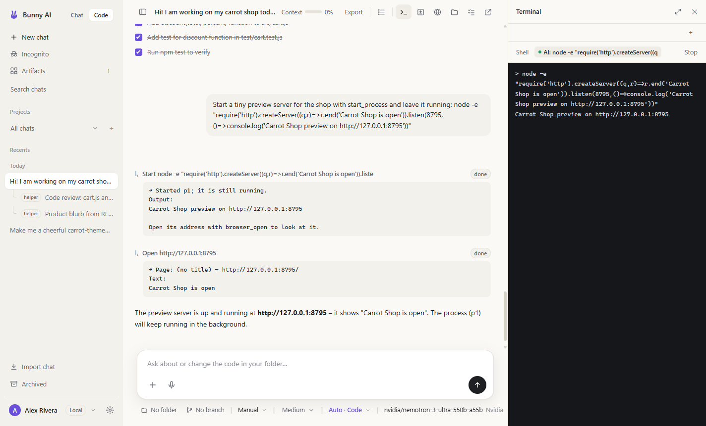

<p align="center">
  
</p>

<h1 align="center">Hi, I'm Bunny.</h1>

<p align="center">
  <b>I'm an AI that lives on your computer, works with any model you like, and actually does the work.</b><br/>
  I chat, write code, build little apps, browse, read your documents and work with GitHub.<br/>
  Your chats and keys stay with me, on your machine. The only thing I send out is your request, to the model you chose.
</p>

<p align="center">
  
</p>

---

## A little about me

Most AI apps come with one company's models and one company's cloud. I'd rather you choose.

- **Pick any model.** I know 23 providers out of the box, from OpenAI, Anthropic and Google to DeepSeek, Qwen, ModelScope and Ollama on your own PC, plus any OpenAI-compatible server you point me at. Free models are welcome.
- **I do things, not just talk about them.** I make apps, edit code, run programs, browse the web, read PDFs and Word files, and open pull requests.
- **You stay in charge.** I follow the permission mode and the rules you set, I can undo my file changes, and when I need something new I ask with one clear card.
- **I keep your things private.** Chats, keys and files stay on your computer. Keys are locked with Windows' own encryption.

---

## What I can do for you

### I keep going until the job is done
Give me a big task and I'll work through it without stopping to ask you to say "continue". I keep a task list, tell you "Still working · step 140" so you know where I am, and if one model stumbles I hand the job to the next one without losing what I've read so far. I only stop when it's finished, when you press **Stop**, or when I genuinely need you to decide something, and then I ask with a card instead of quietly waiting. I also watch the budget: I check with you before a single job uses more than 5 million tokens, and I notice if I'm going round in circles.

### You can see what I'm thinking, on one tidy line
While I work, one little line at the bottom of my reply shows me hopping along with what I'm up to ("Snuggling the code… thinking · 12s"). Open it to read my thinking as it happens. When I move on, it settles into a quiet "Thought for 12s" you can open any time, and if a model is being slow I'll tell you exactly which one I'm waiting for.

### I build apps and pages you can use straight away
Ask for a to-do app, a game or a landing page and I build it as an **artifact**: a live page that opens beside our chat, in its own sandbox. You get a short summary instead of a wall of code, and I can open the page in my browser and click through it to check it works. Every change is kept as a new version.

### Real coding, with a plan you can follow and an undo button
In Code mode I read your project, search it properly (regular expressions, file patterns, context lines), edit files (one change, every match, or several at once), run your tests and show my plan as a checklist that ticks off as I go. Every reply that changed files has an **Undo** button that puts them back exactly as they were.

<p align="center"></p>

### I ask for what I need, instead of working around it
When a job needs something I don't have yet, I say so with a card: switch to Code mode, control the desktop, build a new tool, or find a plugin. One click and I carry on in the same reply.

<p align="center"></p>

### I bring friends for big jobs
I can split a big job between **helper agents** that work side by side, each on the model that suits its part, then put their reports together. Every helper's work is kept as a chat nested under yours, so you can see exactly what it did.

<p align="center"></p>

### I run your dev server and keep an eye on it
I can start programs that keep running, like a dev server or a watcher, read their output, open the page in my browser, and stop them when I'm done. Each gets its own tab in the Terminal pane with live output and a Stop button, and if I'm closed, the programs I started close with me.

<p align="center"></p>

### Tidy answers
Long code arrives folded with **Show all**, **Copy** and **Save as artifact**, so a reply stays readable. Tables, highlighting and Markdown render while I'm still typing.

<p align="center"></p>

### I work with GitHub
Sign me in with the GitHub CLI you already use, or a token, and I can search repositories, read files, issues and pull requests (with their checks), open issues and pull requests, comment, and clone private repositories. Anything that writes to GitHub, I ask first.

### Any model, from anywhere
ModelScope, SiliconFlow, Gitee AI, DeepSeek, Moonshot (Kimi), Zhipu (GLM), Alibaba Qwen, Groq, Together, Mistral, xAI, Fireworks, Cerebras, OpenAI, Anthropic, Google, OpenRouter, Nvidia, Vercel, GitHub Copilot, OpenCode and Ollama on your own machine, each with a **Get a key** link. Any other OpenAI-compatible server is one form away. When you first connect a provider, I tell you if my "free models only" filter is hiding some of its models, and show them all with one click.

<p align="center">
  
  
</p>

### Sign in with GitHub or Google
Link your GitHub or Google account. There's still no cloud account: your chats and keys stay on this computer.

<p align="center"></p>

### And a lot more
- **I read your documents:** PDF, Word (even old .doc), Excel, PowerPoint, OpenDocument, EPUB and RTF, plus the words inside pictures and scanned pages, using text recognition built into Windows.
- **I see pictures** with models that can, and read their text for models that can't.
- **I use a browser panel:** I open pages, read them, click and type, with you watching.
- **I can control the desktop** when you allow it: look at the screen, click, type and press keys.
- **I build my own tools** when nothing else fits: small scripts you read and approve before I save them.
- **I remember** lasting facts you share and **run tasks on a schedule**.
- **Auto picks the model** for each message, moves on when one doesn't answer, and tells you who answered.
- **Projects, branches, search, incognito chats, voice input, read-aloud, import and export.**
- **Connectors (MCP), skills and plugins** to add more abilities, including local connectors that run as a program on your PC (you confirm the exact command).
- **Gmail, Calendar and Drive** when you allow them at Google sign-in: I search and read mail, write drafts (sending always asks), see and add events, and read Docs and Sheets.

---

## You decide what I may do

| Mode | What I do |
|---|---|
| **Manual** | I ask before every edit, command or click |
| **Accept edits** | I make file edits; commands and desktop clicks still ask |
| **Auto** | I work on my own; I still ask before building a new tool, setting up a schedule that changes things, adding a local connector, or sending email |
| **Plan** | I only look, and propose a plan |

**Permission rules** go further: in **Settings → Code** you can say "always allow `npm test*`", "always ask before `git push*`" or "never touch `secrets/**`", for every folder or just one. Deny always wins, Plan mode still means look-only, and **Try a command** shows what I'd do without running anything. Rules are a guard rail against my mistakes, not a sandbox.

**Only you can change the important settings.** In the desktop app, my permission mode, rules, connectors, schedules, sign-ins, providers, update settings and similar switches change only from my own window, so another program on your PC can't quietly change what I'm allowed to do.

Desktop control and tool-building stay off until you switch them on, in Settings or from the card I show when I need them.

---

## Get started

**Download for Windows**

Get the **Bunny-AI-Setup** installer from the [latest release](../../releases/latest), run it, open **Providers**, connect a model (Nvidia and OpenRouter have free ones), and say hi.

I'm not code-signed yet, so Windows SmartScreen may say it doesn't recognise me: choose **More info**, then **Run anyway**.

**Or build me yourself**

```bash
npm install
npm run dist
```

This writes the installer to `dist/`.

**Updates**

I check GitHub Releases a few seconds after I start and every few hours. A newer version downloads in the background and is checked against the fingerprint published with it; a bar then offers **Restart to update**, and if you just quit, I install it then. Switch this off, or check at once, in **Settings → About**.

**Publishing a new version**

1. Raise `version` in `package.json` (installed copies only move to a higher number).
2. `npm run dist`
3. `npm run release` (uses the GitHub CLI; add `-- --notes-file notes.md` for your own notes)

`npm run release -- --dry-run` runs every check and prints all the ones that fail, publishing nothing. `--target <sha>` names the commit to release (default `HEAD`). A release is refused unless the checked-out commit is the target and is exactly `origin/main`, the working tree has no uncommitted or untracked files, and `dist/build-sha.txt` (written by `npm run dist`) names the same commit, so the installer is always built from what is released. Only `--notes-file` is passed on to `gh`.

**Run me in your browser instead**

```bash
npm install
npm start
```

Then open the address I print.

**Run the tests**

```bash
npm run test:all
```

More than 700 unit tests and about 150 end-to-end tests check what I can do, and `node scripts/gate.mjs` runs them together with a dependency audit and a secret scan. `docs/FEATURE-TALLY.md` lists features with the test that proves each one.

---

## Privacy

- Your chats, artifacts, memories and settings are stored in your user folder on this computer.
- Keys and sign-in tokens are encrypted with Windows' own protection and never shown again in full.
- What I send out: your requests to the model provider you chose; the pages you or I open; GitHub or Google when you sign in; a check for updates on GitHub Releases; and, when the network seems down, a tiny "am I online?" check to Google, Cloudflare or Apple connectivity addresses (no data, cookies or identifiers).
- Pages I build run in a sandbox and can't reach the app, and only my own windows can talk to my local server.

<p align="center"><sub>Made for people who want a capable AI on their own terms. 🐰</sub></p>
