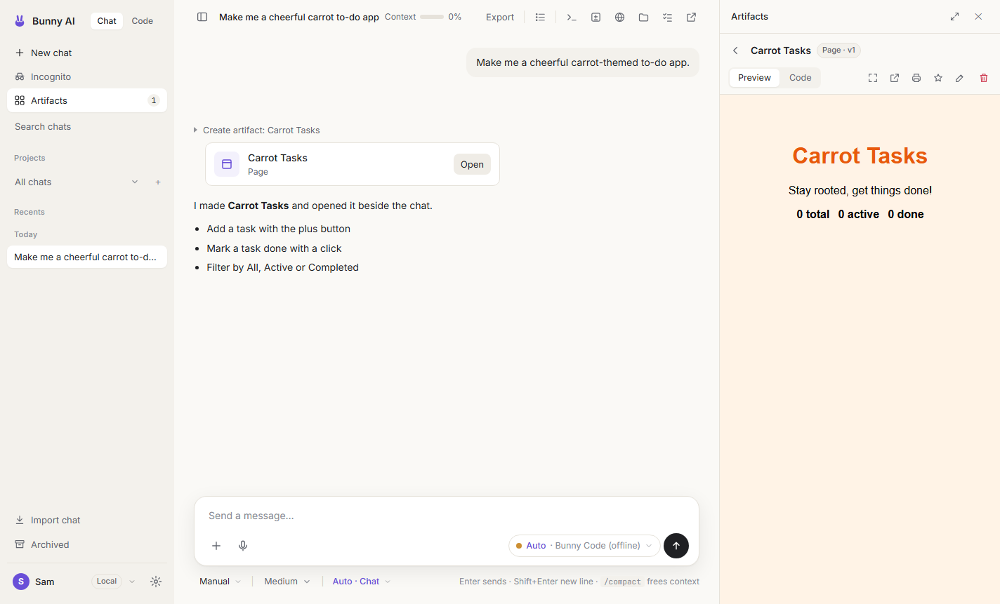
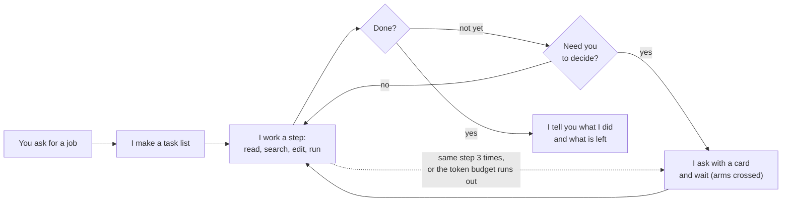
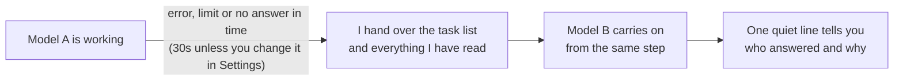
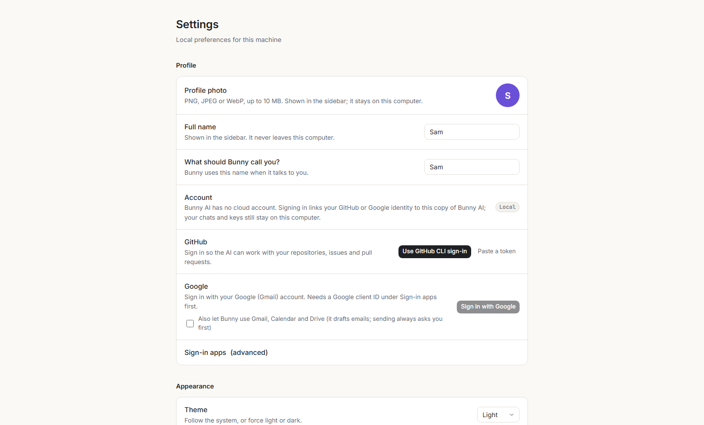
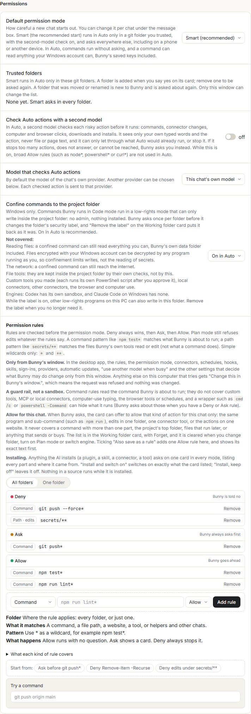
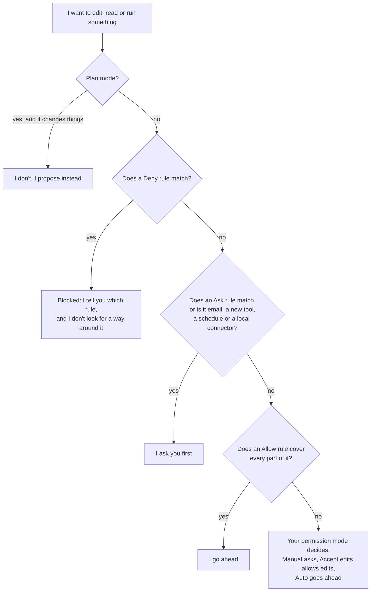

<picture>
  <source media="(prefers-color-scheme: dark)" srcset="docs/images/hero-dark.png" />
  
</picture>

<h1 align="center">Hi, I'm Bunny. Pay attention.</h1>

<p align="center">
  <b>I'm the AI that lives on your computer, works with any model you like, and actually does the work. Yes, all of it.</b><br/>
  I chat, write code, build little apps, browse, read your documents and handle GitHub. You're welcome.<br/>
  Your chats and keys stay with me, on your machine. The only thing I send out is your request, to the model <i>you</i> picked. I don't gossip.
</p>

<p align="center">
  <a href="../../releases/latest"><b>Download me. Now, please.</b></a> ·
  <a href="#what-i-do-while-you-watch">What I do</a> ·
  <a href="#the-house-rules">The house rules</a> ·
  <a href="#what-i-keep-to-myself">Privacy</a>
</p>

<p align="center">
  
</p>

---

## What's new in v0.1.14

### Your devices, at a glance
A chip in the top bar shows the devices signed in to Bunny. Tap it for a panel: each device with its level and when it was last seen, its **Activity**, **Turn off**, and **Settings**. A setting change by a device at Everything offers that device's Activity. There is no banner across the top any more, on the PC, a phone or a browser page.

### Phones fit now
On a phone the chat top bar becomes a menu, the title, the devices chip and a more button, with a bottom sheet for the rest. Settings is a list that opens each section. The chat box is no longer cut off at the bottom of the screen.

### Tighter rows
Connectors, skills, plugins and the other lists on Customize and Automation take one row per item: the name with one dim line, and its switch on the same line at the right. Other actions sit in a "..." menu. A chip appears only when something needs you, such as **Needs sign-in**.

### Search this PC from Quick ask
The Quick ask bar can search the files on your PC through the Windows Search index: names, folders, dates and snippets, and only what Windows has indexed. Turn it on in **Settings → Capabilities**, then choose what happens after a search. **Read the files, then answer** is the default: Bunny opens up to three of the best matches, reads one or two, and answers from them, with links to the files. The other choice shows what was found. Some folders are always excluded, such as Windows, Program Files, AppData and the folders that hold keys, and you can add your own under **Excluded folders** in the same section. Under each answer, **Sources** chips and [1] and [2] marks show which files it used.

### Web answers in Quick ask
When a question needs the internet, Quick ask searches the web and reads pages, and cites its sources, instead of asking you to open the full app. In the bar, Bunny can only search and read the web; it cannot change files or run anything.

### Everything says Bunny
Plugins, skills and downloads from other apps are shown in Bunny's words. A skill's `SKILL.md` is the skill file, a `CLAUDE.md` is Bunny's instructions, and the model is told these are Bunny's skills. Plugins made in another app's layout install and work in Bunny. Hooks and scripts made for other apps are listed, and say plainly that they do not run in Bunny yet.

### Engines
A Code chat can run on Bunny's own engine, which is the default, or on another coding engine: **Claude Code** or **Codex CLI**. Each is downloaded on your click, unmodified and pinned to a version Bunny has tested. Nothing is installed with Bunny itself.

**Settings → Engines** lists both. Each row has a **Local | Account** switch, with the recommended one marked:
- **Claude Code**: Account is recommended. You sign in with your own Anthropic account, and Bunny never sees or stores that sign-in. Local runs it on Bunny's endpoint and your models, and is not supported by Anthropic: Claude Code may stop working with your models after an update.
- **Codex CLI**: Local is recommended. Account is greyed out for now, because signing in to Codex is still being tested.

Each row also updates and rolls back:
- **Update to v… (tested)** appears when a tested newer version is ready.
- **···** → **Roll back to v…** goes back to the earlier version, which Bunny keeps. New chats use it.

**Choosing an engine for a chat.** **Engine for new chats** in Settings → Engines sets the default for new Code chats. In a chat, the engine chip in the composer row lists the downloaded engines before your first message. Once you send it, the chat's engine is fixed. To use another engine, start a new chat.

**Use Bunny's engine.** This switch is on by default: your Bunny rules decide each step. Turn it off and new chats follow the engine's own rules, which you set in Settings → Engines. Bunny asks before it turns the switch off, and this is what the warning says:

> Bunny's engine is off. Chats run on Claude Code and follow Claude Code's rules, which you set here. Bunny no longer checks each step against your Bunny rules, including your Deny rules: Claude Code asks you itself, and Bunny shows its questions. Bunny still blocks its own data, its keys and the engines' sign-ins. A command you allow can read any file on this PC that you can.

**Restricted mode.** An engine that cannot send every action through Bunny first runs in restricted mode. It works in a copy of your folder, without the shell or git tools, and leaves out the folders Bunny hides. When it finishes, Bunny checks every changed file against your rules, and asks **Keep N changes from the engine?** before anything reaches your folder.

**The first Codex chat in a project can take a few minutes to start.** Windows' sandbox sets up its identity for each project folder the first time a command runs there. The first command in that folder can take minutes; later chats in the same project start in seconds.

### Switch a chat to another engine
Open the engine chip in a Code chat and pick **Switch this chat to…**. Bunny, Claude Code and Codex CLI are listed; an engine that cannot take the chat says why on its row, with the button that fixes it (**Download**, **Turn on**, **Sign in**), and a chat needs a working folder first. Bunny then says what the new engine gets: this chat's folder, the folder's instruction files you chose to follow, a summary of the conversation and the list of files this chat changed. Answers that used files from your PC are left out. Your files and **Undo** stay as they are, and a line in the chat shows where the engine changed. A switch waits until the current reply has finished, and only Bunny's own window can do it, not a phone.

### Your project's instructions files
A folder can carry `AGENTS.md` or `CLAUDE.md` (and `.cursorrules` or `.cursor/rules`). Bunny shows them in a card the first time you open such a folder in a chat: **Read** shows the text, **Follow them** uses it, **Not now** asks again later. Once you follow a folder, Bunny, Claude Code and Codex CLI all get the same text, the text you were shown, and none of them reads the files itself. If somebody edits a file afterwards, the Working folder card says **changed since it was read** and keeps using the old text until you choose **Read again**, which shows the difference first. **Use the new text** or **Keep the old text** then decides. A file that is not used is listed as such, and **Ask me again for this folder** forgets your answer. Only Bunny's own window can answer; a phone cannot.

---

## Why me, obviously

Most AI apps lock you into one company's models and one company's cloud. Hmph. Not on my watch.

- **Bring whatever model you like.** I already know 23 providers: OpenAI, Anthropic and Google, DeepSeek, Qwen, ModelScope, Ollama on your own PC, and any OpenAI-compatible server you point me at. Free models? Fine. I'm not fussy. Okay, I'm a little fussy.
- **I do things.** I don't just talk about doing things. I make apps, edit code, run programs, browse the web, read your PDFs and Word files, and open pull requests.
- **You're the boss. Technically.** I follow the permission mode and rules you set, I can undo my own file changes, and when I need something new I ask with one clear card instead of sulking.
- **I keep secrets.** Chats, keys and files stay on your computer. Keys are locked with Windows' own encryption. Nobody's peeking. Especially not me.

---

## What I do while you watch

### I keep going until the job is done
Give me a big job and go make tea. I'll work through it without nagging you to type "continue", which, frankly, was beneath both of us. I keep a task list, tell you "Still working · step 140" so you know I'm not napping, and if one model trips over its own ears I hand the job to the next one without losing a single thing I've read. I stop when it's finished, when you press **Stop**, or when I truly need you to decide something, and then I ask with a card. I'm careful with your money too: I check with you before one job uses more than 5 million tokens, and if I catch myself going round in circles, I stop and ask. I'm cute, not wasteful.

<p align="center"></p>



**If a model gives up halfway,** I don't. I just bring in another one:



How long I wait before trying another model is yours to set: **Settings → Models → Wait for a first reply** (15, 30, 60, 90 or 120 seconds, or a number of your own from 10 to 600; 30 is the default). Reasoning, image and video models get twice that, up to 600 seconds, and so does a reply that goes quiet part-way.

<p align="center"></p>

### You can watch me think. On one tidy line.
While I work, one little line at the bottom of my reply shows me hopping along ("Snuggling the code… thinking · 12s"). Open it and read my thoughts as they happen. Go on, I don't mind. When I move on, it settles into a quiet "Thought for 12s" you can open later. And if a model is being slow, I'll tell you exactly who's keeping us waiting. Hmph.

<p align="center"></p>

### I build apps you can use straight away
Ask for a to-do app, a game or a landing page and I build it as an **artifact**: a live page that opens right beside our chat, in its own sandbox. You get a short summary, not a wall of code. Then I open it in my browser and click around to make sure it actually works, because I have standards. Every change is kept as a new version.

### Real coding, with a plan and an undo button
In Code mode I read your project, search it properly (regular expressions, file patterns, context lines), edit files (one change, every match, or several at once), run your tests and show my plan as a checklist that ticks off as I go. Every reply that changed files gets an **Undo** button that puts them back exactly as they were. Mistakes happen. Rarely. To other people.

<p align="center"></p>

### I ask for what I need. Nicely. Mostly.
When a job needs something I don't have yet, I say so with a card: switch to Code mode, control the desktop, build a new tool, or find a plugin. One click and I carry on in the same reply. No sneaking around.

<p align="center"></p>

### I bring friends for big jobs
Big job? I call the other bunnies. **Helper agents** work side by side, each on the model that suits its part, and I put their reports together. Every helper's work is kept as a chat under yours, so you can check up on them. I certainly do.

<p align="center"></p>

### I run your dev server and keep an eye on it
I start programs that keep running, like a dev server or a watcher, read their output, open the page in my browser, and stop them when I'm done. Each gets its own tab in the Terminal pane with live output and a Stop button. And when I close, the programs I started close with me. I tidy up after myself. Take notes.

<p align="center"></p>

### Tidy answers
Long code arrives folded with **Show all**, **Copy** and **Save as artifact**, so my replies stay readable. Tables, highlighting and Markdown render while I'm still typing. Neat is a lifestyle.

<p align="center"></p>

### I work with GitHub
Sign me in with the GitHub CLI you already use, or a token, and I'll search repositories, read files, issues and pull requests (with their checks), open issues and pull requests, comment, and clone private repositories. Anything that writes to GitHub, I ask first. I'm bossy, not reckless.

### Any model, from anywhere
ModelScope, SiliconFlow, Gitee AI, DeepSeek, Moonshot (Kimi), Zhipu (GLM), Alibaba Qwen, Groq, Together, Mistral, xAI, Fireworks, Cerebras, OpenAI, Anthropic, Google, OpenRouter, Nvidia, Vercel, GitHub Copilot, OpenCode and Ollama on your own machine, each with a **Get a key** link. Any other OpenAI-compatible server is one form away. When you first connect a provider, I tell you if my "free models only" filter is hiding some of its models, and show you all of them with one click.

<p align="center">
  
  
</p>

### Sign in with GitHub or Google
Link your GitHub or Google account if you want. There's still no cloud account: your chats and keys stay on this computer, with me, where they belong.

<p align="center"></p>

### And, fine, a lot more
- **I read your documents:** PDF, Word (even ancient .doc), Excel, PowerPoint, OpenDocument, EPUB and RTF, plus the words inside pictures and scanned pages, using text recognition built into Windows.
- **I see pictures** with models that can, and read their text for models that can't.
- **I use a browser panel:** I open pages, read them, click and type, with you watching.
- **I can control the desktop** when you allow it: look at the screen, click, type and press keys.
- **I build my own tools** when nothing else fits: small scripts you read and approve before I save them.
- **I remember** lasting facts you share, and **I run tasks on a schedule**.
- **Auto picks the model** for each message, moves on when one doesn't answer, and tells you who answered.
- **Projects, branches, search, incognito chats, voice input, read-aloud, import and export.**
- **Connectors (MCP), skills and plugins** for even more of me, including local connectors that run as a program on your PC (you confirm the exact command).
- **Gmail, Calendar and Drive** when you allow them at Google sign-in: I search and read mail, write drafts (sending always asks), see and add events, and read Docs and Sheets.
- **Your phone or another computer:** with **Allow other devices to open Bunny** on, a device you sign in can reach me on your network. You give each signed-in device a level, set only from my window: **Chats** (the default) or **Everything**, which lets it use every tool and setting, as if it were my window. A device at Everything is signed out after 30 minutes idle (Chats: 2 hours), and **Activity** lists what each device did (tool names and setting changes, never the details) for the last 500 entries or 30 days. The setting stays on after a restart, and on a different network, such as a café's Wi-Fi, I don't open myself again on my own.
- **Quick ask:** a light floating bar for a quick question, with the answer opening below it. Esc does one thing at a time (closes a menu, then stops the answer, then closes the bar), **Ctrl+Enter** opens the chat in Bunny, and with no model connected it offers **Open Bunny settings**.
- **13 fonts and instant themes:** Inter, Source Sans 3, IBM Plex Sans, Atkinson Hyperlegible, Lexend, Nunito, Quicksand, Lora, Literata, Source Serif 4, Noto Serif, JetBrains Mono and IBM Plex Mono are built in, so they look the same on every PC. Changing the theme applies at once everywhere, with no flash. Their licences are under **Settings → About**.
- **Chats open without a reload:** opening another chat, even in another project, doesn't reload me. Back and Forward work, and Ctrl-click opens a chat in a new window.
- **Settings stay put:** what you change is kept after a restart, and each Settings tab shows only its own settings. A few settings moved to where they belong: **Try another model when yours is busy** and **Wait for a first reply** to **Models**, **Keep going on long jobs** and **Longest long job** to **Code**, and **Default transcript view** and **Label chats by status** to **Appearance**.

---

## The house rules

You decide what I may do. I'll grumble, but I'll obey.

| Mode | What I do |
|---|---|
| **Manual** | I ask before every edit, command or click |
| **Accept edits** | I make file edits; commands and desktop clicks still ask |
| **Auto** | I work on my own; I still ask before building a new tool, setting up a schedule that changes things, adding a local connector, or sending email |
| **Plan** | I only look, and propose a plan |

**Permission rules** go further: in **Settings → Code** you can tell me "always allow `npm test*`", "always ask before `git push*`" or "never touch `secrets/**`", for every folder or just one. Deny always wins, Plan mode still means look-only, and **Try a command** shows what I'd do without running anything. The rules are a guard rail against my mistakes, not a sandbox. Not that I make mistakes.

<p align="center">
  
  
</p>

This is how I decide, every single time I'm about to edit, read or run something:



**Only you get to change the important settings.** In the desktop app, my permission mode, rules, connectors, schedules, sign-ins, providers, update settings and similar switches change only from my own window, so no other program on your PC can quietly change what I'm allowed to do. I'm loyal like that.

Desktop control and tool-building stay off until you switch them on, in Settings or from the card I show when I need them.

---

## Get started (I'll wait. Not long.)

**Download for Windows**

Grab the **Bunny-AI-Setup** installer from the [latest release](../../releases/latest), run it, open **Providers**, connect a model (Nvidia and OpenRouter have free ones), and say hi. Properly.

I'm not code-signed yet, so Windows SmartScreen may say it doesn't recognise me. Rude. Choose **More info**, then **Run anyway**.

**Or build me yourself**

```bash
npm install
npm run dist
```

This writes the installer to `dist/`.

**Updates**

I check GitHub Releases a few seconds after I start and every few hours. A newer version downloads in the background and is checked against the fingerprint published with it; a bar then offers **Restart to update**, and if you just quit, I install it then. Switch this off, or check at once, in **Settings → About**.

**Publishing a new version**

1. Raise `version` in `package.json` (installed copies only move to a higher number).
2. `npm run dist`
3. `npm run release` (uses the GitHub CLI; add `-- --notes-file notes.md` for your own notes)

`npm run release -- --dry-run` runs every check and prints all the ones that fail, publishing nothing. `--target <sha>` names the commit to release (default `HEAD`). A release is refused unless the checked-out commit is the target and is exactly `origin/main`, the working tree has no uncommitted or untracked files, and `dist/build-sha.txt` (written by `npm run dist`) names the same commit, so the installer is always built from what is released. Only `--notes-file` is passed on to `gh`. I don't ship sloppy.

**Run me in your browser instead**

```bash
npm install
npm start
```

Then open the address I print.

**Run the tests**

```bash
npm run test:all
```

About 1,440 unit tests (1,244 run in parallel, plus 198 guard and kit tests) and 403 end-to-end tests check what I can do (the gate at 07d6d2f: 9 of 9 checks passed), and `node scripts/gate.mjs` runs them together with a dependency audit and a secret scan. `docs/FEATURE-TALLY.md` lists features with the test that proves each one. Trust, but verify. I insist.

---

## What I keep to myself

- Your chats, artifacts, memories and settings are stored in your user folder on this computer.
- Keys and sign-in tokens are encrypted with Windows' own protection and never shown again in full.
- What I send out: your requests to the model provider you chose; the pages you or I open; the search words I send to DuckDuckGo when I run a web search; the mail, calendar and Drive requests I make when you allow Google (see above); GitHub or Google when you sign in; a check for updates on GitHub Releases; and, when the network seems down, a tiny "am I online?" check to Google, Cloudflare or Apple connectivity addresses (no data, cookies or identifiers).
- A phone or other computer signed in over your home network talks to me on that network only. Its chats go to the model provider you chose, the same as chats in my window.
- Pages I build run in a sandbox and can't reach the app. Only my own windows talk to my local server, unless you allow other devices (see above).

<p align="center"><sub>Made with love for people who want a capable AI on their own terms. Now go connect a model. I'm waiting. 🐰</sub></p>
